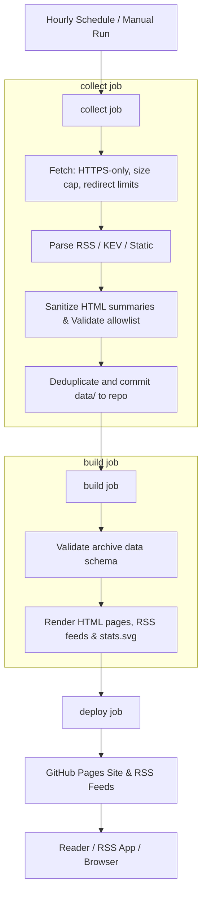

# Threat Feed

## TL;DR

Threat Feed is a GitHub Actions-powered RSS intelligence service. Every hour it collects trusted cybersecurity news, advisories, research, and exploited vulnerabilities. It validates and sanitizes the input, commits structured data, builds a static dashboard/site, and publishes category RSS feeds through GitHub Pages.

- **Collects**: Security news, advisories, research, and exploited vulnerabilities (CISA KEV) from a fixed, trusted source list.
- **Validates & Sanitizes**: Enforces strict URL allowlists, HTTPS-only hops, size/timeout caps, an XML entity-expansion check, and HTML tag stripping for clean plain-text reading.
- **Static Output**: Builds a static HTML site with category views, monthly archives, a statistics dashboard, and one RSS feed per category.
- **Hourly Automation**: Runs via GitHub Pages and GitHub Actions every hour with zero long-lived credentials and robust concurrency protection.

## Architecture



## Features

- **Categories**: Exploited, Advisories, News, and Research.
- **Statistics Dashboard**: Visualizes monthly feed volume and errors with an SVG trend chart (`stats.svg`) plus operational counts.
- **Subscribe Page**: Easy RSS subscription links for all categories.

## Security Model

- **Zero Trust Feed Data**: Everything from feeds is treated as untrusted, size-capped, reduced to plain text, and validated against strict schemas at build and collect time.
- **Link Allowlist**: Links are retained only if they use plain HTTPS and point to the source's own allowlisted domain (`link_domains").
- **Strict Isolation**: GitHub Actions permissions are locked down (`permissions: {}` by default); the build job has no write access or secrets.
- **Robust Defenses**: XML entity-expansion checks, redirect hop validation, and per-job workflow timeouts prevent hangs and memory exhaustion.

## Deploy Your Own

1. Fork this repository and keep it public (private repos have limited free Actions minutes).
2. Go to **Settings > Pages** and set Source to **GitHub Actions**.
3. Go to **Settings > Actions > General** and ensure workflows from outside contributors require approval.
4. Edit `data/feeds.json` to configure your sources, `link_domains`, and keywords.
5. Go to the **Actions** tab, select **Threat feed**, and click **Run workflow** to perform the initial build.
6. Subscribe to your feeds using the links on your site's **Subscribe** page.

## Local Development

1. Create a Python 3.12 virtual environment:
   ```bash
   python3 -m venv venv
   source venv/bin/activate
   ```
2. Install dependencies with hashes:
   ```bash
   pip install --require-hashes -r requirements.txt
   ```
3. Run the collection and build pipeline:
   ```bash
   python main.py collect
   GITHUB_REPOSITORY=owner/repo python main.py build
   ```
4. Serve the generated `_site/` directory locally using any static web server.

## Updating Dependencies

1. Edit `requirements.in` to add or modify packages.
2. Regenerate hashes and locked dependencies:
   ```bash
   pip-compile --generate-hashes requirements.in
   ```
3. Review the diff before committing.

## Notes & Limits

- Keyword filtering rules and scoring logic are fully public.
- The `data/` directory is committed to the repository and publicly visible.
- **Archive policy**: collection filters apply only to new items. Valid archived records are immutable history and are not re-filtered when interests or source keywords change. Records that fail schema or current source allowlist validation are intentionally excluded from the generated site and reported during builds.
- **Source permissions**: `data/feeds.json` contains only the RSS and KEV sources selected for the public workflow.
